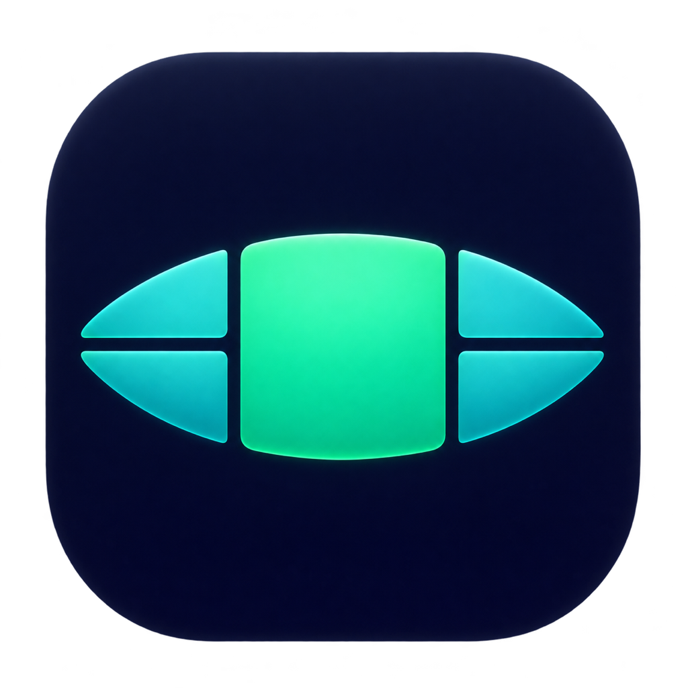
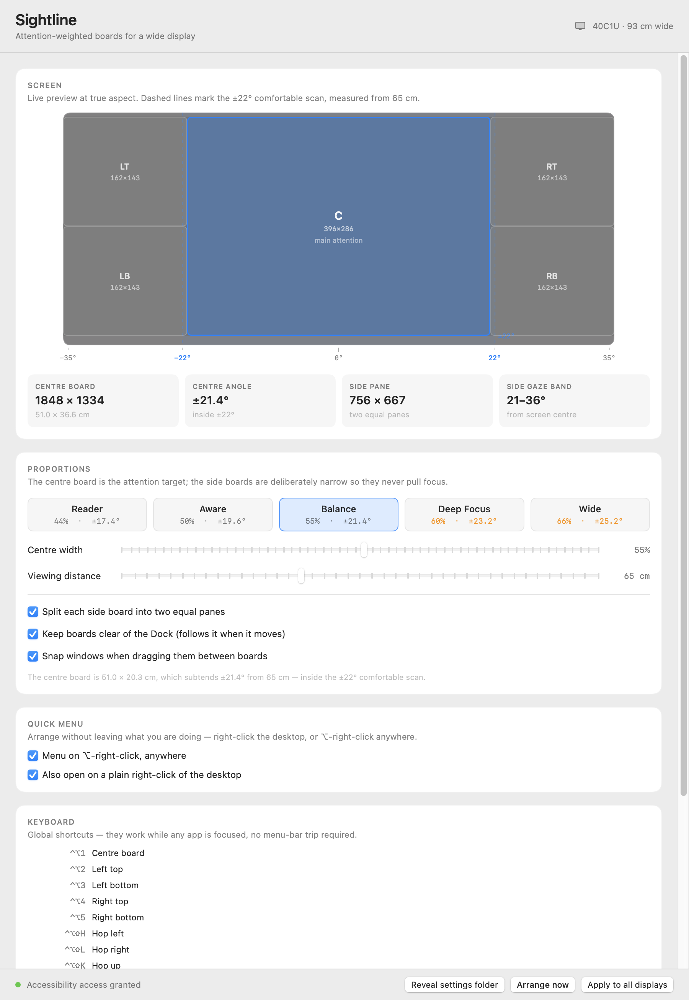

# Sightline

A menu-bar window manager for wide displays, built around one idea: **the centre of the
screen is where attention lives, so the centre board should be the one you work in**, and
the two side columns should be deliberately narrow — ambient, glanceable, never competing.



On a 40-inch 5K display at 65 cm the centre board is 1848 × 1334 pt and spans ±21.4° of
your visual field — inside the ~±22° cone you can read without turning your head. Each side
column (756 pt) splits into two equal panes (756 × 667 pt) for things you only check.
Boards abut with no gutter; the only 1 pt of margin is at the very bottom of the screen,
where macOS refuses to let a full-height window sit flush.

- Design rationale, geometry proof and roadmap: [docs/DESIGN.md](docs/DESIGN.md)
- Five logical boards: `C`, `LT`, `LB`, `RT`, `RB` — stable identities across two geometry
  modes (triptych and split), so a window never loses its board.
- Native Swift + AppKit; one dependency, [Sparkle](https://sparkle-project.org) for
  self-updates, vendored at build time. No accessibility hacks, no telemetry.
- **Follows the Dock**: put it on the left, right or bottom edge, or resize it, and the
  boards re-fit within a second — no relaunch, no window left underneath.
- **⌥-drag to snap**: hold Option while dragging any window and the boards light up;
  release over one and it lands there. No shortcut to fight over, no edge zones to hit.

## Install

```bash
./Scripts/build_app.sh          # release build, bundle, sign, verify
open build/Sightline.app
```

The first build fetches Sparkle (about 16 MB, resumable) into `Vendor/Sparkle/` — run
`./Scripts/fetch_sparkle.sh` yourself if you want that download out of the way first.

Requires macOS 14+ and Xcode Command Line Tools (Xcode is only needed for `swift test` and
for universal builds). Building inside a sandboxed agent workspace needs `--disable-sandbox`,
which the script already passes.

On first launch, Sightline asks for **Accessibility** access
(System Settings → Privacy & Security → Accessibility). It needs it to move and resize
other apps' windows; it never reads window contents. The grant is per app *identity*, so
rebuilding from source can invalidate it — see the next section.

Sightline lives in the menu bar. Click the icon for the full command list, or open
Settings from there (or with `⌃⌥,`). The first item in that menu — **Arrange all
windows** — fills every board in one click: the focused window goes to the centre, then
apps return to the boards they sat on last time, and only the remaining boards are
filled by size. Nothing is closed or minimised; windows beyond the fifth board stay
where they are. The memory is per display and per app, and **Forget app-to-board
memory** sits right under Arrange in the menu if you want a fresh sort.

## Signing, Gatekeeper and permissions

You do **not** need an Apple Developer account to build or run this from source.

`Scripts/build_app.sh` signs with, in order:

1. `SIGHTLINE_SIGN_IDENTITY`, if you export one;
2. the first `Apple Development` certificate in your keychain, if there is one;
3. ad-hoc, with an explicit `designated => identifier "io.github.yuz0101.Sightline"`
   requirement.

Step 3 is the interesting one. A plain ad-hoc signature creates a designated requirement
based on the binary's cdhash, which changes on every build, and macOS keys the Accessibility
grant to that requirement — so you would re-approve the app each time you compile. An
explicit identifier-based requirement is stable across builds, so contributors without any
Apple account keep their grant.

The release script signs the app with a *Developer ID Application* certificate and submits
it to Apple for notarization. Notarization does not grant Accessibility —
every machine still approves the app once in System Settings.

## Releasing

Maintainers only. Requires Apple Developer Program membership and a **Developer ID
Application** certificate (an `Apple Distribution` certificate is for the App Store and
does not work for notarization).

```bash
# once: store notary credentials (app-specific password from appleid.apple.com)
xcrun notarytool store-credentials SightlineNotary \
  --apple-id you@example.com --team-id YOURTEAMID

# every release
DEVELOPER_ID_APP="Developer ID Application: Your Name (TEAMID)" ./Scripts/release_app.sh
```

For API-key notarization, set `ASC_KEY_PATH`, `ASC_KEY_ID`, and the team key’s
`ASC_ISSUER_ID` instead of configuring a Keychain profile.

The script builds a universal (arm64 + x86_64) app, signs it with the hardened runtime and
a secure timestamp, submits it to Apple's notary service, staples the ticket, checks it
with `spctl`, and leaves `build/Sightline.zip`, its SHA-256 and a signed `build/appcast.xml`
next to it. Upload the ZIP, checksum and `appcast.xml` to the GitHub release.

## Updates

Sightline updates itself with Sparkle, using a signed appcast attached to GitHub Releases.
`SUFeedURL` in `Resources/Info.plist` points at
`https://github.com/yuz0101/Sightline/releases/latest/download/appcast.xml`, so the
newest release's feed is always the one the app reads.

- The **Check for Updates…** menu item checks immediately; otherwise the app checks once a
  day in the background, downloads quietly and offers to install.
- Every build carries the EdDSA public key in `SUPublicEDKey`; the maintainer keeps
  the private signing key outside Git. Sparkle refuses an update whose signature does not match, so a
  compromised download server cannot ship a different app.
- Create the key pair once, on the machine that will sign releases:

  ```bash
  ./Vendor/Sparkle/bin/generate_keys      # prints the public key
  ```

  Paste that base64 key into `SUPublicEDKey` in `Resources/Info.plist`. Keep the private key
  in the login keychain (that is where `generate_keys` puts it) and back it up: losing it
  means every existing install has to be replaced by hand. Set `SPARKLE_PRIVATE_KEY_FILE`
  to use an existing private key file outside Git.

- Publishing a release:

  ```bash
  # 1. bump CFBundleShortVersionString and CFBundleVersion in Resources/Info.plist
  # 2. build, sign, notarize, staple, package and write the appcast
  DEVELOPER_ID_APP="Developer ID Application: Your Name (TEAMID)" ./Scripts/release_app.sh
  # 3. publish the artifact and the feed together
  gh release create v0.2.0 build/Sightline.zip build/Sightline.zip.sha256 build/appcast.xml \
    --title "Sightline 0.2.0" --notes "…"
  ```

  The appcast must be uploaded as an asset named exactly `appcast.xml`, because
  `releases/latest/download/appcast.xml` resolves by asset name.

## Shortcuts

`⌃⌥` + a digit places; `⌃⌥⇧` + everything else manipulates. Placing a window where another
one sits **never evicts** it: the two windows swap boards.

| Shortcut | Action |
| --- | --- |
| `⌃⌥1` | Place the focused window in the centre board |
| `⌃⌥2` / `⌃⌥3` | Place in left top / left bottom (whole left column when unsplit) |
| `⌃⌥4` / `⌃⌥5` | Place in right top / right bottom |
| `⌃⌥⇧H` / `⌃⌥⇧L` | Hop the focused window one board left / right |
| `⌃⌥⇧K` / `⌃⌥⇧J` | Hop up / down within a split column |
| `` ⌃⌥` `` | Cycle the centre stage forward (`⌃⌥⇧`` ` `` backward) |
| `⌃⌥⇧T` | Send the focused window to the centre stage |
| `⌃⌥⇧S` | Toggle the side split |
| `⌃⌥[` / `⌃⌥]` | Previous / next preset |
| `⌃⌥−` / `⌃⌥=` | Narrow / widen the centre board by 1 % |
| `⌃⌥⇧R` | Arrange all windows on this display into the boards |
| `⌃⌥⇧F` | Fill the screen |
| `⌃⌥⇧C` | Centre the window at its current size |
| `⌃⌥⇧A` / `⌃⌥⇧Z` | Save / restore the arrangement |
| `⌃⌥,` | Settings |

### Drag to snap

Keyboard coverage is not always enough — a key can be owned by another app, or you may
simply be holding the mouse already.

- **Any window snaps** with a plain drag. Pick it up, drop it over a board, and it fills
  that board — including a window that is not on a board yet, such as one you just
  created. The boards are the model, not a gesture, so there is nothing to remember first.
- The occupant of the board you dropped on takes the board you came from, so the two
  windows trade places. If you dropped onto an empty board, the source board is simply
  left empty.
- **Hold ⌥ to force a snap.** It matters when a drag starts *and* ends on the same board:
  by default that drag leaves the window where you put it (nudging it inside its board),
  and ⌥ pulls it back to the board's exact frame. ⌥ only has to be down as the drag
  starts; letting go before the mouse release is fine.

While you drag, an overlay dims the screen, outlines all five boards and fills the one
under the pointer, so the preview is exactly what you will get.

- The modifier is Option rather than Control because `⌃`-click is a secondary click — a
  `⌃`-drag on a title bar opens a context menu instead of moving the window.
- Nothing happens without the drag traveling at least 26 pt, so clicks and text selection
  are untouched. A plain drag of a *floating* window still does whatever macOS did before.
- The board a window came from is read when you press, not when the drag begins: by the
  first drag event the window has already moved and no longer sits in its old board.
- Toggle it in Settings ("Snap windows when dragging them between boards") or from the
  Layout menu. It needs no extra permission beyond Accessibility, because it only
  *observes* the drag and then moves the window on release.

### Quick menu

Right-click an empty part of the desktop and the first item is **Arrange all windows**. It
is the same action as the menu-bar item, the `⌃⌥⇧R` shortcut and the Settings button, but
it is reachable without leaving whatever you are doing. The menu also carries "Place
focused window", the stage commands, New Folder (`⌘⇧N`), Change Wallpaper…, Settings and
Quit.

`⌥` + right-click works too, anywhere on any screen. Reach for it when you are over an app
window and do not want to move the pointer first.

Finder's own desktop menu cannot be extended by other apps, so Sightline intercepts the
plain right-click only when the pointer is over the wallpaper itself — no window, icon or
Dock item. Those keep their own menus, which is why right-clicking a file on the desktop
still shows Finder's items.

Both gestures are toggleable in Settings: "Quick menu on ⌥-right-click" and "Also open on a
plain right-click of the desktop".

### Why HJKL and not arrows

Rectangle's stock shortcuts own `⌃⌥` + arrows (halves), `⌃⌥C`, `⌃⌥F` and most of the
`⌃⌥` letters. Carbon hotkeys are first-come-first-served and a losing registration fails
*silently* — the key simply does nothing, with no error to report. We measured this on
macOS 15.8: a synthetic `⌃⌥⇧←` never reached our handler while `⌃⌥⇧T` did, so
control-arrow combinations are consumed before Carbon sees them. Hence `HJKL`.

If another app still owns one of these keys, the menu and Settings show the binding but the
key will be dead. Quit the other manager (Rectangle, Magnet, Raycast's window commands) or
change the conflict there.

## Presets

Measured on the 40-inch 5K at 65 cm (usable width 3360 pt):

| Preset | Centre | Centre width | Half-angle | Feels like |
| --- | --- | --- | --- | --- |
| Reader | 44 % | 1478 pt | ±17.4° | one document, sides as narrow strips |
| Aware | 50 % | 1680 pt | ±19.7° | the conservative ergonomics default |
| **Balance** | **55 %** | **1848 pt** | **±21.4°** | **default: one focus + two live sidelines** |
| Deep Focus | 60 % | 2016 pt | ±23.2° | centre is king, sides become trays |
| Wide | 66 % | 2218 pt | ±25.2° | for tables and timelines |

The comfort band is bounded on both sides: centre aspect ≥ 1.25 needs ≥ 49.6 % of the
width, and ±22° needs ≤ 56.5 %. Outside that band the diagram marks the layout as outside
the comfortable scan.

Layouts are stored per display (identified by display UUID), so a laptop and the 40-inch
keep separate proportions. `avoidDock` is global.

## How it works

```
Sources/SightlineCore/   pure layout + attention math (no AppKit, fully tested)
Sources/Sightline/       the app: preferences, displays, AX driver, snap controller,
                           Carbon hotkeys, HUD, SwiftUI settings
Sources/sightline-cli/   prints the live tree, presets and angles; --json for tooling
Tests/SightlineCoreTests 10 tests: coverage, exact halves, no overlap, angles, round-trips
```

- **Coordinates.** Accessibility uses global top-left, y-down, in points — the same space as
  `CGDisplayBounds`; only AppKit needs a flip. `ScreenSpace` is the single conversion point.
- **Moves.** `size → position → size`, because macOS clamps a window to the current screen
  when you try to grow it past the edge. Every move is read back (±2 pt) and retried once.
- **State.** `SnapController` remembers which window sits on which board (by PID + window
  id, falling back to title) and verifies it against the live frame, so windows moved by
  hand or by another app stop being "owned" instead of being teleported later.
- **Stage.** The centre board has a queue. Rotating brings the next window in and the
  outgoing one takes the incoming one's old board — a true swap, so nothing is ever lost.

## Verifying a build

```bash
# unit tests (needs Xcode's XCTest, not just the command line tools)
DEVELOPER_DIR=/Applications/Xcode.app/Contents/Developer swift test --disable-sandbox

# live geometry for your display
swift run --disable-sandbox sightline-cli

# end-to-end: AX moves, swap semantics, a real Carbon hotkey, a hop
pkill -x Sightline
SIGHTLINE_SELFTEST=1 build/Sightline.app/Contents/MacOS/Sightline

# render the settings window to a PNG without Screen Recording permission
SIGHTLINE_SNAPSHOT=/tmp/settings.png build/Sightline.app/Contents/MacOS/Sightline

# log trust state, hotkey failures and every screen's computed boards
SIGHTLINE_VERBOSE=1 build/Sightline.app/Contents/MacOS/Sightline
```

The self-test creates two throwaway windows, places them through every board, checks the
swap, posts a synthetic `⌃⌥1` and `⌃⌥⇧H`, drives the drag pipeline into `RB`, then drags a
second window onto the centre from LT and checks that the two windows traded boards.
Quit the running app first, or its hotkeys will handle the events instead.

## Not built yet

- User-editable shortcuts. The binding table is one enum; a recorder UI is the next step.
- Window thumbnails on the side panes (ScreenCaptureKit), and the focus-shade overlay.
- Notarisation and an updater for distribution.

## Tooling worth installing

- `swift-format` (Apple) — one command keeps the tree consistent: `swift-format -ir Sources Tests`.
- `SwiftLint` — catches force-unwraps and other AX-layer foot-guns; pair it with `periphery`
  to find dead code after refactors.
- `xcbeautify` — readable output if you later drive this from `xcodebuild`.
- `KeyboardShortcuts` (sindresorhus) — if/when shortcuts become user-editable, it replaces the
  hand-rolled Carbon layer with a recorder UI; the Carbon path stays as the no-dependency default.
- `Sparkle` — only when you ship this to other people.
- Xcode's **Accessibility Inspector** and `log stream --predicate 'subsystem == "io.github.yuz0101.Sightline"'`
  are the two fastest ways to debug a refused resize.

## One-line philosophy

A wide monitor is not one canvas; it is one place you look and two places you notice.

## License

MIT — see [LICENSE](LICENSE).
