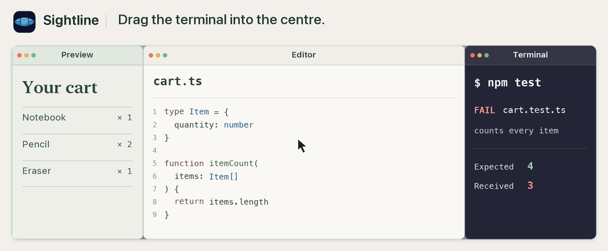
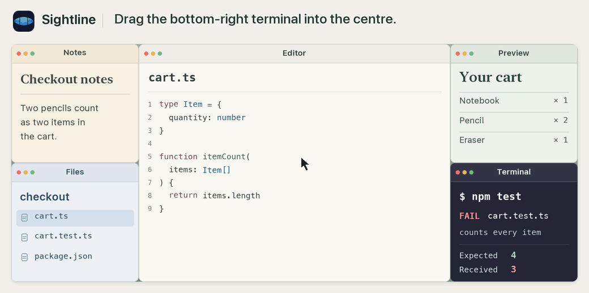

# Sightline — an attention-friendly macOS window manager for ultrawide monitors

While you’re writing code, your editor needs your attention. The terminal where your AI coding agent is running tests might only need a glance. Sightline is a free, open-source Mac menu bar app that gives your editor a wide centre pane and keeps up to four other windows in view at the sides.

If a test fails, **drag the terminal by its title bar until the centre pane lights up.** The terminal snaps to fit as soon as you let go, and your editor takes the terminal’s old spot at the side. Once you’ve read the error, drag your editor back to the centre to make the fix.

[Download Sightline for Mac](https://github.com/yuz0101/Sightline/releases/latest/download/Sightline.zip) · macOS 14 Sonoma or later · Apple silicon and Intel

This release includes faster drag snapping and the keyboard swap shown in the demos. [Release notes for v0.0.1](https://github.com/yuz0101/Sightline/releases/tag/v0.0.1).

<picture>
  <source media="(prefers-reduced-motion: reduce)" srcset="docs/assets/window-swap-still.png">
  
</picture>

## Try it on your Mac

1. Unzip the download, move **Sightline** to **Applications**, and open it. The app is signed with a Developer ID and notarized by Apple.
2. Give Sightline **Accessibility** access in **System Settings → Privacy & Security → Accessibility** so it can move and resize your windows.
3. Open your editor, a Claude Code terminal and a browser preview on the same display. Click your editor and choose **Arrange all windows** from Sightline’s menu bar icon. To see the swap for yourself, drag the preview from its side pane into the centre.

## Keep your sources beside your draft

If you write with ChatGPT, Gemini or Perplexity, try turning off **Layout → Split side boards**. That gives you three tall columns. Put your draft in the middle, the conversation on the left and the article you’re citing on the right. Open the article in its own browser window so you can glance over to check a quote halfway through a sentence.

## Make the layout fit your desk

The **Balance** preset starts you off with 55% of the usable screen width in the centre. Widen it if a side-by-side diff feels cramped, or narrow it if you like shorter lines when you write. [Why the centre pane is wider](docs/DESIGN.md).

Want a test log just below your browser preview? Turn on **Layout → Split side boards** for a five-window layout. Drag the terminal from the bottom right into the centre to read a failure. Your editor takes its place below the preview, while your notes and files stay in view on the left.

<picture>
  <source media="(prefers-reduced-motion: reduce)" srcset="docs/assets/five-window-swap-still.png">
  
</picture>

[Watch the keyboard version of this swap](docs/DESIGN.md#44-swap-with-centre).

Drop a window into an empty pane and it snaps to fit. You can also nudge a window within its own pane and it stays where you leave it.

Sightline remembers where you last put each app on each display. When you have a setup you’d like to come back to, choose **Arrangements → Save arrangement**. The next time those windows are open, choose **Restore arrangement** to put them back in place.

See the layout settings

 

## Get in touch

If a window lands somewhere unexpected, let us know which app and display you were using. Ideas for other layouts are welcome too. [Open an issue](https://github.com/yuz0101/Sightline/issues/new).

If you’d like to help with code or documentation, you can build Sightline on your own Mac. [Contributing guide](CONTRIBUTING.md).

[MIT License](LICENSE)
