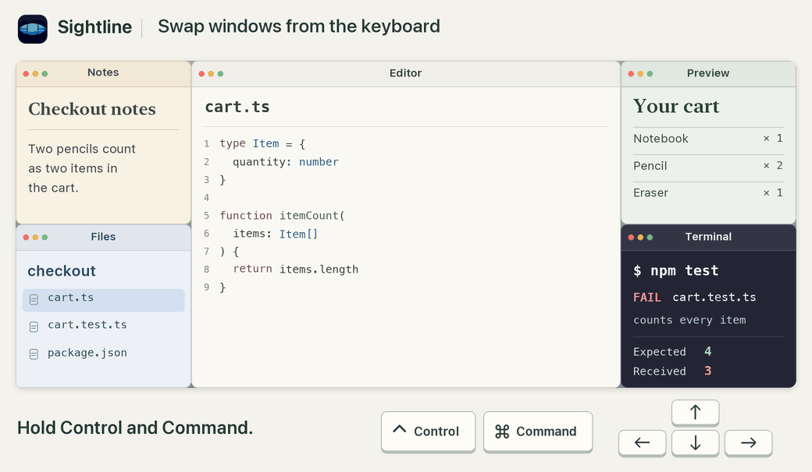

# Sightline — Design

*A window manager that splits the screen the way human attention actually works.*

Status: **design v1.0** · 2026-11-20 · target macOS 15+ (Apple Silicon) · reference display 40″ 5K2K ultrawide (3360 × 1418 pt at 2×, 92.8 cm wide)

---

## 0. One-paragraph summary

Sightline is a menu-bar window manager for very wide displays. Instead of dividing the
screen into equal thirds, it divides it into **a centre board sized to the human foveal
comfort cone** (about 55 % of width, ±21.4° of visual angle) and **two peripheral columns**
sized to what the eye can monitor without turning the head. Each peripheral column can
split into two near-square panes, producing a five-slot triptych: **C** (centre), **LT/LB**
(left top/bottom), **RT/RB** (right top/bottom). Windows move between slots as a
**permutation**: every move swaps two windows, so a board is never left empty and no window
is ever lost. The centre board is a **stage** with a queue — the stage menu rotates the next
staged window in and sends the current one back to the slot it came from. Geometry is
fixed by muscle memory; only roles change.

---

## 1. Design principles

| # | Principle | Consequence for the product |
|---|-----------|----------------------------|
| P1 | **Attention has a shape.** Detail work is only comfortable inside a cone of roughly ±20–22° horizontally (22° is our hard ceiling); beyond that, the head and eyes must move and re-acquire context. | The centre board's edges are placed at the edge of that cone, not at "1/3 of the screen". |
| P2 | **The screen is larger than the comfortable field.** A 92.8 cm-wide panel at 65 cm subtends 71.0°; the centre board's comfort cone is 42.8° and each side column runs from 21.4° to 35.5°. | Splitting is not cosmetic; it is a *perceptual allocation* problem. |
| P3 | **Moving a window is cheap; re-finding it is expensive.** | Slot semantics are stable. Moves are swaps. Window title memory is preserved in arrangements. |
| P4 | **Peripheral content is ambient, not readable.** Peripheral vision detects motion, colour and luminance change, but not fine detail. | Side panes host glanceables (chat, CI, logs, reference), never the primary reading task. |
| P5 | **The layout is a contract.** Repeated geometry builds spatial muscle memory. | Boards abut with no gutter, fixed slot grid, no auto-reflow. Layouts are named and user-editable but never surprise. |
| P6 | **Native, dependency-free, private.** A window manager needs Accessibility and must run forever; every dependency is a lifetime risk. | Swift + AppKit + SwiftUI, zero third-party runtime dependencies, no network, no telemetry. |

---

## 2. The attention model

### 2.1 Geometry of this display

| Quantity | Value |
|---|---|
| Logical resolution | 3360 × 1418 pt (6720 × 2836 px @2×) |
| Physical size (40″, aspect 2.370) | 92.8 × 39.2 cm |
| Scale | 36.2 pt/cm (72.4 px/cm) |
| Usable frame (menu bar 25 pt + Dock 59 pt) | 3360 × 1334 pt, origin y = 25 |
| Usable height | 1334 pt ≈ 36.8 cm |
| Horizontal field of view at 65 cm | **71.0°** |
| Vertical field of view at 65 cm (usable height) | **31.6°** |

`python3 Tools/attention_math.py` regenerates the geometry and preset table.

### 2.2 Three zones

```
        ┌──────────────┬───────────────────────┬──────────────┐
        │  AMBIENT     │        FOCAL          │   AMBIENT    │
        │ 21.4°–35.5°  │       ±21.4°          │ 21.4°–35.5°  │
        │  motion,     │   detail, reading,    │   motion,    │
        │  status      │   writing, coding     │   status     │
        └──────────────┴───────────────────────┴──────────────┘
         ← 22.5 % →        ← 55 % →           ← 22.5 % →
```

* **Focal zone (0 – ±21.4°)** — high acuity, saccade-free. The only place a *task* belongs.
  The limit is a convention rather than a cliff: comfortable gaze rotation without head
  movement is commonly placed at 20–25° for sustained work, and we cap at 22°.
* **Glance zone (±21.4–32°)** — the inner part of a side column, readable with a short,
  deliberate eye movement. Good for "I need to check that" content: chat threads, CI
  status, terminal tail.
* **Ambient zone (±32–35.5°)** — the outer edge of the same column. Motion and colour only.
  Good for presence indicators, clocks, build lights, media. Not for reading.

Both side bands live inside the same 756 pt column; glance and ambient describe what each
part of it is good for, not separate slots.

### 2.3 Choosing the centre width — two constraints, one answer

Two hard constraints bracket the centre board:

| Constraint | Requirement | Implied centre width |
|---|---|---|
| **A. Perceptual** | centre half-width ≤ 22° at the chosen viewing distance | ≤ **56.5 %** at 65 cm |
| **B. Productive** | centre pane must be a usable work surface, i.e. aspect ratio ≥ 1.25 : 1 at 1334 pt tall (≥ 1668 pt wide) | ≥ **49.6 %** |

The feasible band is **49.6 – 56.5 %**. The default is **55 %** — 1848 × 1334 pt
(1.39 : 1), starting at x = 756 pt, with 756 pt side columns and edges at **±21.4°**.

The band is *distance-dependent*, which is why the ratio is configurable and the settings
window reports degrees, not just percent: at 55 cm the perceptual cap falls to ~47.9 %, at
80 cm it rises to ~69.7 %. **Percent is a proxy; degrees are the design unit.**

### 2.4 Presets

| Preset | C / sides | Centre (pt) | Centre aspect | Centre ±° | Side pane | Use |
|---|---|---|---|---|---|---|
| **Reader** | 44 / 28 / 28 | 1478 × 1334 | 1.11 | 17.4 | 941 × 667 (1.41) | Long-form reading, writing; near-portrait page |
| **Aware** | 50 / 25 / 25 | 1680 × 1334 | 1.26 | 19.6 | 840 × 667 (1.26) | Three roughly-equal tasks, review |
| **Balance** *(default)* | **55 / 22.5 / 22.5** | **1848 × 1334** | **1.39** | **21.4** | **756 × 667 (1.14)** | Coding, design, general work |
| **Deep Focus** | 60 / 20 / 20 | 2016 × 1334 | 1.51 | 23.2 | 672 × 667 (1.01) | Single task, everything else ambient |
| **Wide** | 66 / 17 / 17 | 2218 × 1334 | 1.67 | 25.2 | 571 × 667 (0.86) | Video/timeline work, fewer side needs |

Three of the five presets deliberately sit outside the 49.6–56.5 % comfort band: Reader is
narrower than the 1.25 aspect floor, Deep Focus and Wide exceed the 22° cap. The settings
UI labels them **outside comfort band** rather than removing them — sometimes you want the
screen to be a bit uncomfortable.

The happy accident of 55 %: splitting each 756 pt side column into two gives **756 × 667
pt panes (aspect 1.14)** — near-square tiles that suit chat, terminal tails and log views
far better than tall slivers.

### 2.5 Why not equal thirds?

Equal thirds give a centre of 1120 × 1334 pt — **aspect 0.84, a portrait column**. It is
perceptually fine (±13.4°) but *productively* wrong: code, tables and video all need
landscape. Equal thirds optimise the eye and ignore the work. The triptych breaks the
symmetry deliberately: **the centre is wider than the sides because the work is
concentrated in the centre.**

### 2.6 Vertical

Usable height is only 31.6° of field of view, so vertical splits are cheap: two stacked
panes of 667 pt (666 on the bottom row) still span only ±8.1°. That is why the side columns split vertically
rather than horizontally — a horizontal split would produce four 366 pt-wide slivers.
**Never stack more than two rows**: a third row drops to 444 pt, which is not enough for a
window's chrome plus content.

### 2.7 What the evidence says and does not say

The geometry above is a design choice informed by vision science, not derived from it.
Keeping the two apart matters, because "attention-optimised layout" claims usually
overstate what has actually been measured.

* **(a) Measured — acuity collapses outside the fovea.** The fovea is about 5.2° across,
  the perifovea extends to roughly 17°, and pattern recognition degrades sharply beyond
  that (Strasburger, Rentschler & Jüttner 2011). Fine reading really does need the centre.
* **(b) Assumption — the useful field of view is roughly ±15–20°.** That figure is a rule
  of thumb from applied vision testing (useful-field-of-view screening), not a measured
  acuity boundary; the fovea/perifovea transition is smooth and task-dependent. We use it
  as a sanity check, never as a hard edge.
* **(b) Assumption — 22° is the comfort cap.** Comfortable gaze rotation without head
  movement is conventionally placed at 20–25° for sustained work; there is no cliff at 22°.
  We pick 22° because it is the conservative end of that range and lands on a workable
  56.5 % ceiling at 65 cm.
* **(a) Measured — gaze returns to the centre.** Observers fixate the centre of the screen
  irrespective of the distribution of image features, and the bias survives when the
  feature distributions are manipulated (Tatler 2007). A centre-weighted layout matches
  where people look anyway; a left-weighted one has to fight the bias.
* **(a) Measured — interruptions cost stress, and the 23-minute figure is folklore.**
  Interrupted tasks in a controlled study were completed *faster* and no worse, but with
  more stress, frustration, time pressure and effort (Mark, Gudith & Klocke 2008). Field
  data agree that interruption is the norm — 57 % of working spheres were interrupted —
  and that interrupted work tends to be resumed the same day, after intervening activities
  (Mark, González & Harris 2005). The widely quoted "23 minutes to resume" is usually
  pinned on the 2008 paper; it is not in it, and we could not verify it in the 2005 paper
  either. Treat it as **(c) unknown**: we do not budget for it.
* **(b) Assumption — the F-pattern justifies the left column. It does not.** The F-pattern
  is a within-column scan path: the left gazes fall on the left of the *content area*, not
  the leftmost part of the screen, and a navigation rail routinely captures them (Pernice
  2017). It describes how people scan a text column, not where a wide screen's primary
  column should sit.
* **(b) Assumption — no left-periphery advantage at 60–70 cm.** Reading-order and
  handedness effects produce small left-side attentional asymmetries in some tasks, but at
  65 cm on a 92.8 cm display we would expect any such advantage to be small relative to a
  side column's 14° of visual angle, and we found no measurement that would justify an
  asymmetric layout. Both sides stay identical.
* **(c) Unknown — whether a stage queue beats Z-order for real users.** The queue is a
  bet that deterministic rotation beats order that changes under you. It is a good bet, but
  it is ours; M2 ships it behind a preference so it can be turned off.

---

## 3. Layout system

### 3.1 Slots

```
┌──────────────────────────────────────────────────────────────┐
│  menu bar (25 pt)                                            │
├────────────┬──────────────────────────────┬──────────────────┤
│    LT      │                              │        RT        │
│  22.5 %    │              C               │      22.5 %      │
├────────────┤             55 %             ├──────────────────┤
│    LB      │                              │        RB        │
│  22.5 %    │                              │                  │
├────────────┴──────────────────────────────┴──────────────────┤
│  Dock (61 pt)                                                │
└──────────────────────────────────────────────────────────────┘
```

The slot area is the usable frame: 3360 × 1334 pt at y = 25, starting at x = 0.

Five logical slots, always addressable, in two geometry modes:

* **Triptych** (`sideSplit = false`): L = full column, R = full column. Three visible boards.
* **Split** (`sideSplit = true`): L = LT over LB, R = RT over RB. Five visible boards.

Slot names never change between modes, so the same gesture works in both layouts.

### 3.2 Geometry rules

| Rule | Value | Rationale |
|---|---|---|
| Arrange all | One command, focused window to C, then LT/RT/LB/RB; rebuilds the mapping instead of chaining moves | Chaining `place` calls cascades displacements; a rebuild is deterministic and leaves windows beyond the fifth board untouched |
| Arrange memory | Per display, app → board, written on every successful placement; memory claims a board before size order | Re-arranging should reproduce the layout you left, not re-sort by window size; keying on the app means it survives the window being closed and reopened |
| Gutter between boards | 0 pt — boards abut | macOS gives every window its own border and shadow, so a gutter only exposed a strip of wallpaper, made the union non-contiguous, and left a dead strip for drag-to-snap hit-testing |
| Outer margin | 0 pt | Flush to the screen edge; maximises content |
| Top inset | menu-bar height (25 pt; safe-area aware) | Never hide window chrome under the menu bar |
| Dock | `visibleFrame`, followed live (see §3.5) | Boards never sit under the Dock, and it can be moved to any edge or resized while the app is running |
| Rounding | integral points (round size) | Avoids 1 px seams between panes |
| Bottom edge | the layout stops 1 pt above the usable bottom | macOS clamps any window that would fill the usable height to 1 pt less; stopping every board on that line keeps one straight bottom edge instead of a stepped one |
| Side split | exactly 50 / 50, no gutter; the bottom row absorbs the rounding remainder so the column ends on the centre board's bottom line | "Two equal-size boards", as specified, without ever leaving a seam |

The layout engine is a pure function `slots(for screen, layout) -> [Slot: CGRect]`, with no
AppKit side effects, so it is unit-testable and reusable for the settings preview.

### 3.3 Per-display configuration

Each display gets its own layout and its own side-split state, keyed by
`CGDisplayCreateUUIDFromDisplayID`. Displays that have never been configured inherit the
global default. When a display is unplugged its config is retained.

### 3.4 Attention metrics in the UI

The settings window shows, live, for the current slider position and the detected viewing
distance assumption:

* centre size in pt and cm,
* centre half-angle in degrees (the number that matters),
* side-pane aspect ratio,
* a warning when the current ratio puts the centre edge outside 22° *or* the centre aspect
  below 1.25 — the two bounds of the comfort band, both labelled "outside comfort band".

---

### 3.5 Following the Dock

The slot area is `NSScreen.visibleFrame`, so wherever the Dock sits the boards stop at its
edge: bottom (1418 − 25 − 59 = 1334 pt tall), left or right (3360 − 59 = 3301 pt wide).

Dock moves and resizes are followed without a relaunch:

- AppKit posts `NSApplication.didChangeScreenParametersNotification` when the Dock changes
  edge, and the app re-flows tracked windows from it.
- That notification can arrive while `visibleFrame` still reports the old value (the frame
  settles a moment later), and a Dock resize does not always announce itself, so a 1.2 s
  timer also compares the live usable area with the last applied one.
- Both paths debounce for 0.45 s before re-flowing, so an auto-hiding Dock sliding in and out
  or a display that is still reconfiguring does not cause a burst of resizes.
- Re-flow re-applies each tracked window's slot in the new geometry; the drag preview and
  fill-screen use the same refreshed rects.

Example for the reference display (3360 × 1418 pt, Dock tilesize 42): Dock bottom → usable
3360 × 1334 at (0, 25); Dock left → 3301 × 1393 at (59, 25); Dock right → 3301 × 1393 at
(0, 25); tilesize 48 → 3291 × 1393. A window parked in `RB` moved from (2604, 692, 756, 666)
to (2617, 721, 742, 696) and back as the Dock went to the left edge and returned.

## 4. Interaction model

### 4.1 The core commands

1. **Place** — put the focused window in a named slot (swapping with whoever is there).
2. **Hop** — move the focused window one board left/right.
3. **Promote** — swap the focused window with the centre.
4. **Cycle** — rotate the centre stage queue.
5. **Toggle** — change geometry (side split on/off, preset).
6. **Arrange** — fill every board on a display in one action: the focused window takes
   C, then each remaining board goes to the largest window *that remembers sitting
   there*, and only then does size decide. Arranging rebuilds the mapping rather than
   moving windows one at a time, so nothing is displaced by a cascade. Memory is per
   display and per app. Each successful placement records the app’s board, so
   Arrange can put it there again. `Forget app-to-board memory` clears these preferences.

Everything else (arrangements, fill, centre-without-resize) is a convenience built from
these.

### 4.2 Permutation semantics (the core rule)

When a window moves between two occupied boards, the windows trade places. Drag the
same window back to restore the pair. If the incoming window was floating, Sightline
tries to give the other window its previous frame. If the other window cannot fit,
Sightline adds it to the display’s centre stage queue.

### 4.3 The centre stage

The centre board is a **stage with a queue**, not a Z-stack:

```
stage = [ A, B, C, D ]        centre shows A
Next staged window →  centre shows B, A returns to B's previous slot (or queue tail)
```

* Windows enter the stage when placed in C, or explicitly with **Stage Window**.
* Rotating is a swap with the *slot the incoming window came from*, so the layout stays
  full and every displaced window has a home.
* The queue is per-display and survives until the windows close.
* A low-priority HUD (optional, off by default) shows the queue as dots near the centre
  board's bottom edge.

Rationale: the user asked for "switch windows to work on the main board easily"; a queue
gives deterministic, repeatable rotation, unlike Z-order cycling which changes under you.

### 4.4 Swap with centre

Hold **Control + Command** and tap **←** or **→** to highlight an occupied pane on
that side of the active display. In a split column, Sightline starts with the upper
window if available. Tap **↑** or **↓** to choose a row. An empty side clears the
highlight so you can choose the other side.

Release either modifier to exchange the highlighted window with the centre window
and give it keyboard focus. Repeating the gesture returns the original window to
the centre. Window placement, layout and stage commands are available in the menu.

<picture>
  <source media="(prefers-reduced-motion: reduce)" srcset="assets/keyboard-centre-swap-still.png">
  
</picture>

### 4.5 Drag-to-snap (shipped)

Drag a window by its title bar to move it onto a board. Sightline outlines the three
or five boards and highlights the one under the pointer. On release, the window
snaps to fit. When you drag between two occupied boards, the windows trade places.

- **A plain drag is a board move.** That includes a window the app has never tracked — a
  window you just created, or one another app placed — which is the case users report
  first: "I opened a new window, dragged it to the side, and nothing happened." Tracking
  is optional because the window's frame at mouse-down identifies its source board.
- **A drag that starts and ends on the same board is a free move.** The window stays where
  it was put, so it can be nudged inside its board without the layout pulling it back.
  Text selection and content drags never move the window frame, so they never arm the
  overlay at all (the frame must change by 8 pt).
- **`⌥` forces the snap**, including when the drag never leaves its board — the way to pull
  a nudged window back to the board's exact frame. `⌥`, not `⌃`: `⌃`-click is a secondary
  click, so a `⌃`-drag on a title bar opens a context menu instead of moving the window.
  Option is unclaimed here.
- **The gesture tolerates an early `⌥` key-up.** People release the key and the mouse in
  the same motion, and the key-up usually wins the race; requiring Option *at mouse-up*
  dropped those snaps silently. Option only decides the *kind* of drag when it starts.
- **The source board is read at mouse-down**, not at the first drag event. Measured: by
  the first `leftMouseDragged` the window has already moved tens of points, so a
  frame-match lookup ("is this window still exactly in its board?") fails and the swap
  target is lost. Press-time capture also means the board is read while the window is
  still sitting in it.
- **Travel threshold 26 pt**, so clicks, double-clicks and text selection never draw the
  overlay; release slack is 16 pt around the window's own frame, which keeps a title-bar
  drag inside its own window.
- **On release**, Sightline uses the window captured at mouse-down if it still contains
  the pointer. Otherwise it checks the frontmost window at the release point. A single
  WindowServer snapshot narrows the search for the destination's occupant to visible
  candidates. On a global mouse-up, Sightline fits the dragged window immediately,
  then moves the previous occupant. A local mouse-up waits for AppKit's tracking loop
  to finish so it cannot overwrite the final frame.

### 4.6 Arrangements

**Arrangements → Save arrangement** records the display, board, app and title of each
tracked window. When those windows are open again, **Restore arrangement** places
the windows it can match and reports how many it restored.

### 4.7 Quick menu (shipped)

A right-click on empty desktop background opens a small Sightline menu whose first item
is **Arrange all windows**, followed by Place ▸, Cycle, Stage, New Folder, Change Wallpaper…,
Settings and Quit. `⌥`-right-click opens the same menu anywhere, over any window.

* **Taking over the wallpaper's plain right-click.** Finder owns that menu and exposes no
  extension point for it (a Finder Sync extension only receives files and folders), so the
  only way to put Arrange on it is to claim the gesture. Claiming it means carrying the two
  Finder items people actually use from the desktop — New Folder and Change Wallpaper — or
  the trade would be a loss. Both are in the menu. A Settings toggle can hand the plain
  gesture back to Finder.
* **What counts as desktop.** Two independent tests at the click point: no layer-0 window of
  another process covers it (`CGWindowListCopyWindowInfo`), and the Accessibility hit test
  returns role nil, `AXGroup` or `AXWindow`. Measured on 15.8: the wallpaper is an `AXGroup`
  owned by Finder, a file icon is an `AXImage`, a Dock icon is an `AXDockItem`, and app
  content reports leaf roles — so icons and Dock items keep their own menus.
* **Why an event tap and not `NSEvent` monitors.** A monitor can only observe, so Finder's
  own menu would open underneath ours. The tap consumes the pair of right-mouse events.
* **Why the tap runs on its own thread.** Popping up a menu blocks the main run loop; a tap
  installed there is starved, and macOS disables it. Measured on 15.8: with the tap on the
  main run loop the second `⌥`-right-click after a menu produced nothing at all.
* **One stranded mouse-up is enough to break the gesture.** The paired mouse-up is consumed
  even while the menu is open; otherwise the "swallow the next up" flag stays set and the
  following right-click is passed straight through to Finder (the second bug found here).
* **The menu is presented in a borderless host window's view.** `popUp(positioning:at:in:)`
  with a `nil` view returns immediately when the app is a background accessory, so nothing
  appears at all; presenting it in a 1 × 1 host window works on the first click and from a
  cold launch.
* **Escape does not dismiss the menu** — clicking elsewhere does. Reimplemented dismissal is
  not worth a custom menu window while `NSMenu` tracks properly otherwise.
* The gesture needs no permission beyond Accessibility.

### 4.8 Updates (shipped)

The app updates itself with [Sparkle](https://sparkle-project.org) 2. The feed is an
appcast attached to every GitHub release, and `SUFeedURL` points at
`https://github.com/yuz0101/Sightline/releases/latest/download/appcast.xml`, which
always resolves to the newest release's asset by name.

* **Trust is in the signature, not the feed.** Each archive carries an EdDSA signature
  produced by Sparkle's `sign_update`; the matching public key is baked into
  `SUPublicEDKey`. Sparkle verifies the download before unpacking, so a hijacked feed or a
  CDN compromise cannot deliver a different binary. The private key lives in the
  maintainer's keychain and is never committed.
* **Cadence**: one automatic check per `SUScheduledCheckInterval` (86,400 s). A manual
  **Check for Updates…** item sits in both the app menu and the status menu.
* **Install**: Sparkle unpacks beside the running bundle, verifies the code signature, swaps
  atomically and relaunches. No installer, no admin prompt, no Accessibility re-approval —
  the bundle identifier and designated requirement do not change between versions.
* **Sparkle ships inside the bundle.** `Sparkle.framework` is linked from `Vendor/Sparkle`,
  copied into `Contents/Frameworks`, and signed inside-out (Autoupdate, Updater.app, the two
  XPC services, then the framework, then the app). The framework is not fetched through
  SwiftPM: a release tarball is a single resumable download, while SwiftPM needs a git
  clone that is unreliable on the networks this project is developed on.
* **Failure is quiet.** A missing feed or an unreachable GitHub only logs during an
  automatic check; the manual check reports the error to the person who asked.


---

## 5. Visual design

**Menu bar icon** — a three-column glyph, filled on the centre. Left click opens the menu,
right click opens Settings.

**Menu** — Presets ▸, Side split ✓, Stage ▸ (Cycle, Show queue), Arrangements ▸, Settings…,
Permissions…, About, Quit.

**Settings window** (SwiftUI, 720 × 560):

```
┌──────────────────────────────────────────────────────────────┐
│  Sightline                              [Balance ▾] [Reset]│
│  ┌────────────────────────────────────────────────────────┐  │
│  │   ▁▁▁▁▁▁▁▁▁ menu bar ▁▁▁▁▁▁▁▁▁▁▁                       │  │
│  │ ┌────────┬─────────────────────┬────────┐   ← live     │  │
│  │ │  LT    │                     │   RT   │      diagram │  │
│  │ ├────────┤          C          ├────────┤              │  │
│  │ │  LB    │                     │   RB   │              │  │
│  │ └────────┴─────────────────────┴────────┘              │  │
│  │   35.5°    21.4°      0°      21.4°   35.5°            │  │
│  └────────────────────────────────────────────────────────┘  │
│  Centre width  ●───────────────────────  55 %  (1848 pt)     │
│  Visual half-angle  21.4°  ✓ inside comfort cone (≤22°)      │
│  Side pane  756 × 667 pt · 1.14 : 1                          │
│  ☑ Split side boards      Viewing distance  [65 cm ▾]        │
│  Swap with centre                                                   │
└──────────────────────────────────────────────────────────────┘
```

The diagram uses the display's **true aspect ratio**, so the proportions on screen match
the proportions on the desk. Degree ticks are drawn as arcs from the assumed eye point.

**Onboarding** — a single panel: what the app does, a live preview of the triptych, the
Accessibility permission button, and a description of the centre swap. Permission state is
refreshed while the settings window is visible and when the menu opens.

---

## 6. Architecture

```
                    ┌──────────────────────┐
   Ctrl+Cmd+arrows ─▶│ CentreSwapKeyboard   │
                    └──────────┬───────────┘
                               ▼
   menu / settings ──▶┌──────────────────────┐      ┌──────────────────┐
                      │  SnapController      │◀────▶│  StageStore      │
                      │  (the commands)      │      │  queue + slots   │
                      └───┬──────────────┬───┘      └──────────────────┘
                          ▼              ▼
              ┌────────────────┐  ┌────────────────┐
              │ LayoutEngine   │  │ WindowDriver   │
              │ pure geometry  │  │ Accessibility  │
              └────────────────┘  └───────┬────────┘
                                          ▼
                                  other apps' windows
```

| Module | Responsibility | Notes |
|---|---|---|
| `LayoutEngine` | screen frame + layout → slot rects | pure, no imports beyond CoreGraphics; unit-tested |
| `WindowDriver` | enumerate windows, read/write frame, focus | all AX calls isolated here |
| `SnapController` | implement the commands, permutation logic | main-actor |
| `StageStore` | centre queue, window→slot memory | in-memory + JSON persistence |
| `DisplayRegistry` | NSScreen ↔ display UUID ↔ layout | handles hot-plug |
| `Preferences` | ratios, gaps, viewing distance | `Codable` → UserDefaults |
| `CentreSwapKeyboard` | pane selection and modifier release | Quartz event tap on a private run loop |
| `SettingsView` / `OnboardingView` | SwiftUI UI | preview shared with LayoutEngine |

**Threading.** Everything that touches AX or AppKit runs on the main actor. Hot-key events
and screen-change notifications hop to main. No background AX scanning; window lists are
enumerated on demand (one call per action) to keep the CPU profile at zero when idle.

**Persistence.** `~/Library/Application Support/Sightline/state.json` — preferences,
per-display layouts, arrangements, stage hints. Atomic writes.

**Failure handling.** Sightline reads back the frame after moving and resizing a
window. If the app takes time to apply it, Sightline waits 40 ms and retries once.
If the window still cannot fit, a brief on-screen message names the app.

---

## 7. Technical notes

### 7.1 Coordinate spaces

AX positions are **global points with a top-left origin** (y increases downward, origin at
the top-left of the main display). `NSScreen.frame` is **bottom-left origin with y up**.
All layout math is done in one space — top-left global — and converted at the AX boundary:

```
axRect = CGRect(x: nsRect.minX,
                y: primaryScreenHeight - nsRect.maxY,
                width: nsRect.width, height: nsRect.height)
```

Working in a single space avoids the classic multi-display bug where a screen *below* the
primary gets negative AX y-coordinates.

### 7.2 What can and cannot be moved

| Case | Behaviour |
|---|---|
| Standard resizable window | Move + resize |
| Minimised window | Un-minimise first (`kAXMinimizedAttribute`), then place |
| Full-screen window | Refuse and explain; do not silently exit full screen |
| Non-resizable window | Move only, keep size |
| Window on another Space | Not addressable; filtered by on-screen window list |
| Stage Manager | Treated as one window per stage; best effort |
| Apps that ignore AX resize | Retry once, then HUD warning |

Known quirks to handle: Chromium-based apps need `AXEnhancedUserInterface` enabled for
reliable geometry; apps with tab-in-one-window (Safari, Terminal) expose only the window,
which is what we want; Xcode sometimes reports a stale frame right after a resize, so the
read-back treats ±2 pt as success.

### 7.3 Permissions

Only **Accessibility** is required. No Screen Recording (we never read pixels), no
Automation/AppleScript, no network. The app is `LSUIElement` (no Dock icon, no app menu).

On launch: if `AXIsProcessTrusted()` is false, show onboarding with a button that calls
`AXIsProcessTrustedWithOptions([kAXTrustedCheckOptionPrompt: true])` and deep-links to
System Settings ▸ Privacy & Security ▸ Accessibility. The app stays usable for layout
preview without permission; window actions no-op with an explanatory HUD.

### 7.4 Packaging and signing

SwiftPM executable + a hand-assembled `.app` bundle (`LSUIElement`, `CFBundleIdentifier`,
`NSHighResolutionCapable`, `LSMinimumSystemVersion 15.0`), signed with the a **stable Apple
Development identity** when available. This matters: TCC remembers
Accessibility grants by code identity, and re-signing with the same identity keeps the
grant across rebuilds. Ad-hoc signing would re-prompt on every build.

`Scripts/build_app.sh` does: `swift build -c release` → assemble bundle → `codesign --force
--options runtime --sign "Apple Development: …"` → `dist/Sightline.app`.

### 7.5 Deliberate non-goals

* No tiling *daemon* that constantly reflows windows (that fights the user; Sightline
  acts only on request).
* No window decoration, no custom title bars, no injection into other processes.
* No cloud sync, no accounts, no telemetry.
* No App Store distribution (Accessibility-based window managers are not accepted there;
  future Developer ID + notarisation is the path for distribution).

---

## 8. Risks

| Risk | Likelihood | Mitigation |
|---|---|---|
| Some app ignores AX resize | Medium | Retry + read-back + explicit HUD; documented list |
| macOS changes AX behaviour | Low | All AX behind one module; easy to patch |
| Shortcut conflicts with other apps | Medium | Only Ctrl+Cmd+Left and Ctrl+Cmd+Right start the gesture. Up and Down are handled during selection. Dragging also swaps windows. |
| Users on 27″ or laptop find 55 % too wide/narrow | Medium | Ratio is per-display and degree-aware; presets cover 44–66 % |
| TCC grant lost after reinstall | Low | Stable signature; onboarding re-prompt is one click |
| Drag-to-snap instability | Medium | Sightline checks that the window moved before showing a board preview. It snaps another app’s window on mouse-up. For a local drag, it waits until AppKit finishes tracking the window. |

---

## 9. Roadmap

| Milestone | Content | Status |
|---|---|---|
| **M0** | This design, attention math, layout diagrams | done |
| **M1** | Menu-bar app, layout engine, five slots, placement commands, keyboard centre swap and permission flow | this build |
| **M2** | Stage queue + rotation, arrangements save/restore | this build |
| **M3** | Settings window with live attention preview | this build |
| **M4** | Drag-to-snap with preview overlay | shipped |
| **M5** | Focus shade (dim peripheral boards), stage HUD, per-slot app assignment | next |
| **M6** | Multi-display presets, export/import, Sparkle updates | updates shipped; presets later |

---

## 10. Decision log

| Decision | Alternatives | Why |
|---|---|---|
| Native Swift + AppKit | Electron, Python | AX control, global hotkeys and menu-bar lifecycle are native-only in practice; a resident utility must be small and dependency-free |
| Quartz session event tap | Carbon hotkey registration | A gesture needs both arrow events and modifier releases. The tap consumes the selected arrows and forwards ordinary input. |
| Centre 55 % default | Equal thirds, 60 % | 55 % sits inside the 49.6–56.5 % band at 65 cm and its side panes split into 756 × 667 pt near-square tiles; 60 % already breaks the 22° cap |
| Permutation semantics | Evict overflow to centre/edges | Eviction hides windows; permutation is reversible and keeps every board occupied |
| Stage queue | Z-order cycling | Deterministic and repeatable; Z-order changes under the user's feet |
| Five logical slots in two geometry modes | Separate 3-slot and 5-slot layouts | Menu actions, keyboard selection and remembered boards work with either side layout. |
| Single top-left coordinate space | Mixed AppKit/AX spaces | Eliminates multi-display sign errors |
| SwiftPM + hand-assembled bundle | Xcode project | Buildable from CLI, reviewable `.pbxproj`-free, reproducible |
| Quick menu | `⌥`-right-click anywhere plus a plain right-click on bare desktop wallpaper, active event tap on a private run loop | Finder offers no way to extend the desktop context menu and Arrange needs to be one click away; the takeover is scoped by a window-list + AX-role test at the pointer, and carries New Folder and Change Wallpaper so nothing is lost. The tap cannot live on the main run loop because a menu blocks it, and one unconsumed mouse-up strands the swallow flag |
| Updates | Sparkle 2 with an EdDSA-signed appcast on GitHub Releases; the framework is vendored and embedded | Sparkle is the only maintained, permission-free updater for menu-bar apps; signing the archive means the feed host does not have to be trusted, and vendoring avoids a SwiftPM git clone that stalls on this network |
| Dock tracking | `visibleFrame` + a 1.2 s comparison + a 0.45 s debounce | Dock moves do post `didChangeScreenParameters`, but the frame can lag behind it and resizes can be silent; polling is cheap and makes the behaviour true in practice |

---

## References

* Mark, G., González, V. M., & Harris, J. (2005). *No task left behind? Examining the
  nature of fragmented work.* CHI '05, 321–330.
  [doi:10.1145/1054972.1055017](https://doi.org/10.1145/1054972.1055017)
* Mark, G., Gudith, D., & Klocke, U. (2008). *The cost of interrupted work: more speed and
  stress.* CHI '08, 107–110.
  [doi:10.1145/1357054.1357072](https://doi.org/10.1145/1357054.1357072)
* Pernice, K. (2017, November 12). *F-shaped pattern of reading on the web: misunderstood,
  but still relevant (even on mobile).* Nielsen Norman Group.
  [nngroup.com](https://www.nngroup.com/articles/f-shaped-pattern-reading-web-content/)
* Strasburger, H., Rentschler, I., & Jüttner, M. (2011). *Peripheral vision and pattern
  recognition: a review.* Journal of Vision, 11(5):13.
  [doi:10.1167/11.5.13](https://doi.org/10.1167/11.5.13)
* Tatler, B. W. (2007). *The central fixation bias in scene viewing: selecting an optimal
  viewing position independently of motor biases and image feature distributions.*
  Journal of Vision, 7(14):4.
  [doi:10.1167/7.14.4](https://doi.org/10.1167/7.14.4)
